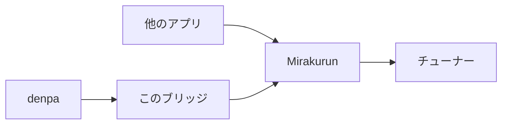

# denpa-mirakurun-bridge

[denpa](https://github.com/danything/denpa) のチューナーエージェント API (`/denpa/*`) を [Mirakurun](https://github.com/Chinachu/Mirakurun) へ中継するブリッジです。
denpa 付属のエージェントの代わりに使うことで、denpa と他のアプリが同じ Mirakurun のチューナーを共有できます。



## 必要なもの

- denpa v2.28.0 以降 (v2.27.0 以前で使う場合は「[古い denpa と HTTP で接続する](#古い-denpa-と-http-で接続する)」を参照)
- Mirakurun
  - `channels.yml` では、地上波を物理チャンネル番号 (`27`)、衛星を中継器の番号で始まる名前 (`BS15_0`・`CS2`) にしておく必要があります
- Docker Compose (Go でビルドして直接動かすこともできます。「[開発](#開発)」を参照)

## 導入

### 既存の Mirakurun を使う場合

denpa の `compose.override.yml` で `tuner-agent` を差し替えます。denpa の compose は `.env` の `AGENT_PAIR_TOKEN` を `tuner-agent` と denpa の `TUNER_AGENT_URL` の両方に渡すため、denpa 側の設定を変える必要はありません。

```yaml
services:
  tuner-agent:
    image: ghcr.io/multiverse2011/denpa-mirakurun-bridge:latest
    cap_add: !reset []
    device_cgroup_rules: !reset []
    stop_grace_period: 10s
    volumes: !override
      - bridge-config:/config
    environment:
      MIRAKURUN_URL: http://mirakurun.lan:40772
      PRIORITY_MAP: "10:2,9:1,8:0,5:0,4:0,3:0,1:0"
volumes:
  bridge-config:
```

### Mirakurun も同時に起動する場合

以下の内容を `compose.yml` として保存し、同じディレクトリに合言葉を書いた `.env` を作ります。

```sh
echo "AGENT_PAIR_TOKEN=$(head -c 32 /dev/urandom | base64 | tr '+/' '-_' | tr -d '=\n')" > .env
```

```yaml
name: denpa

services:
  mirakurun:
    image: chinachu/mirakurun:latest
    restart: always
    cap_add: [SYS_ADMIN, SYS_NICE]
    device_cgroup_rules: ["c *:* rmw"]
    environment:
      TZ: Asia/Tokyo
    volumes:
      - ./mirakurun/config:/app-config
      - ./mirakurun/data:/app-data
      - /dev:/dev
    tmpfs: [/tmp]
    ports:
      - "40772:40772" # 他のアプリ用。不要なら削除

  # denpa の既定の接続先は tuner-agent:25252
  tuner-agent:
    image: ghcr.io/multiverse2011/denpa-mirakurun-bridge:latest
    restart: unless-stopped
    # 録画中は録画が終わるまで待ってから止まる (SHUTDOWN_WAIT)。足りないと待っている途中で kill される
    stop_grace_period: 6h5m
    depends_on: [mirakurun]
    environment:
      MIRAKURUN_URL: http://mirakurun:40772
      PRIORITY_MAP: "10:2,9:1,8:0,5:0,4:0,3:0,1:0"
      AGENT_PAIR_TOKEN: ${AGENT_PAIR_TOKEN:?}
    volumes:
      - bridge-config:/config

  denpa:
    image: ghcr.io/danything/denpa:latest
    restart: unless-stopped
    stop_grace_period: 6h5m
    depends_on: [tuner-agent]
    environment:
      TZ: Asia/Tokyo
      TUNER_AGENT_URL: https://tuner-agent:25252#pair=${AGENT_PAIR_TOKEN:?}
      TRUSTED_NETWORKS: 192.168.0.0/16,10.0.0.0/8
    volumes:
      - denpa-data:/data
      - denpa-recorded:/media/raw
      - denpa-library:/media/encoded
    ports:
      - "3000:3000"

volumes:
  bridge-config:
  denpa-data:
  denpa-recorded:
  denpa-library:
```

Mirakurun のデバイスやカードリーダー、`network_mode: host` などの設定は [Mirakurun の compose](https://github.com/Chinachu/Mirakurun/blob/master/docker/docker-compose.yml) を、denpa の設定は [denpa の compose.prod.yml](https://github.com/danything/denpa/blob/main/compose.prod.yml) を参照してください。

## 設定

設定はすべて環境変数で行います。

| 環境変数 | 既定値 | 説明 |
| --- | --- | --- |
| `MIRAKURUN_URL` | `http://127.0.0.1:40772` | Mirakurun の接続先です |
| `HOST` / `PORT` | `127.0.0.1` / `25252` | 待ち受けるアドレスとポートです。Docker イメージでは `HOST=0.0.0.0` です |
| `PRIORITY_MAP` | なし | denpa の優先度を Mirakurun の優先度に変換する対応表です (例: `10:2,9:1`)。表にない値はそのまま渡し、負の値は 0 にします |
| `KEYLESS_TUNERS` | `1` | 番組表・ロゴの取得やチャンネルスキャンで、新たに使ってよいチューナーの数です |
| `DECODE_KEYLESS` | `0` | `1` にすると、番組表・ロゴ・スキャンの取得でも復号します (`decode=1`)。Sakurako など上流が `decode` の異なる要求を共有しないとき、ライブと同じ復号済みストリームを共有できます。カードやデコーダが不調だと番組表の取得も巻き添えになります |
| `EPG_MODE` | `broadcast` | **実験的機能**です。`synthetic` にすると、`use=epg` を Mirakurun の番組表 (`/api/programs`) から合成して返し、チューナーを使いません。合成できないときは従来のストリーム中継に落ちます。live・rec・scan は変わりません (切り替えは再起動)。短い説明に収まらない説明の後半は extended の「番組内容」に入れますが、denpa の全体検索 (`/search`) は extended を見ないため、後半はそこでは当たりません。地上波の SDT には、denpa が預けたチャンネルの局のうち Mirakurun に無いものを足します。Mirakurun にだけある局は残るため、局が減ったときはスキャン結果との顔ぶれの違いが出ます (EIT は Mirakurun のまま)。`transportStreamId` や `serviceType` の無い古い `channels.json` ではこの補正は効かず、denpa で地上波をスキャンし直すと入ります |
| `CHANNELS_FILE` | `data/channels.json` | denpa から受け取ったチャンネル一覧の保存先です。Docker イメージでは `/config/channels.json` です |
| `AGENT_TLS` | `1` | `0` にすると TLS を使わず HTTP で待ち受けます (v2.27.0 以前の denpa 向け) |
| `AGENT_PAIR_TOKEN` | なし | denpa と組むための合言葉です。未指定なら自動で生成し、`CHANNELS_FILE` と同じ場所の `tls/pair-token` に保存します |
| `AGENT_NAME` | なし | `/denpa/about` の `name` に返すエージェントの名前です。空なら返さず、denpa が URL のホスト名で埋めます |
| `ALLOWED_HOSTS` | なし | `AGENT_TLS=0` のときに受け付けるホスト名です。IP アドレス・`localhost`・ドットを含まない名前・`.local` などは指定しなくても受け付けます |
| `DENPA_VERSION` | `bridge-<バージョン>` | `/denpa/about` が返すバージョンです。denpa のバージョンと揃えると、不一致の通知が出なくなります |
| `SHUTDOWN_WAIT` | `21600000` (6 時間) | 録画中に止めようとしたとき、録画が終わるまで待つ上限 (ミリ秒) です。待つ間も要求は受け付けます。`0` なら待ちません。denpa のエージェントと同じです |
| `MESSAGE_LANG` | `ja` | エラー応答とログの言語です (`ja` / `en`) |

## denpa との接続 (TLS)

denpa とは TLS で接続し、組んだ denpa (クライアント証明書で識別) からの要求にだけ応答します。仕組みは denpa の [docs/agent.md](https://github.com/danything/denpa/blob/main/docs/agent.md) の「denpa とは TLS で組む」と同じで、組むには同じ合言葉 (`AGENT_PAIR_TOKEN`) を両方に設定します。

- 鍵、自己署名の証明書、合言葉、組んだ denpa の証明書の指紋は、`CHANNELS_FILE` と同じ場所の `tls/` (Docker イメージでは `/config/tls`) に保存します。証明書は一度作ったら作り直しません
- まだどの denpa とも組んでいなければ、起動時に組むための URL (`https://<ホスト名>:25252#pair=<合言葉>`) を標準出力に表示します
- 合言葉を変えるには、`pair-token` を削除して再起動します
- denpa の設定からこのエージェントを削除すると、denpa は `DELETE /denpa/pair` を送ります。ブリッジは呼んできた denpa の証明書を `clients` から消して 204 を返します。denpa に届かないときは、`clients` からその行を削除して再起動します
- `DELETE /denpa/pair` は組んだ denpa からしか呼べません。平文 (`AGENT_TLS=0`) にはペアリングが無いため 403 を返します
- TLS ではブラウザがクライアント証明書を提示できず接続できないため、Host ヘッダーと `Content-Type` は検査しません

### 古い denpa と HTTP で接続する

v2.27.0 以前の denpa は HTTP でしか接続できないため、`AGENT_TLS: "0"` を追加します。この場合は認証なしで復号済みの TS を返すので、denpa 以外からアクセスできないようにしてください。`use=rec` を付けた選局が開いている間は止まるのを待つ (`SHUTDOWN_WAIT`) ため、ほかから録画を名乗って開かれると、その分だけ止まるのが遅れます。Host ヘッダーは `ALLOWED_HOSTS` で制限します。

## 仕組み

- **優先度**: denpa の優先度を `PRIORITY_MAP` で変換し、`X-Mirakurun-Priority` として渡します。チューナーの共有や割り込みは Mirakurun に任せます。ただし空きが無いとき、このブリッジ経由の利用者で、denpa の優先度が要求より低いものしかいないチューナーがあれば、その利用者をブリッジが切ってから Mirakurun に頼みます (`PRIORITY_MAP` で同じ値に潰しても、ライブが番組表の取得を取り上げられるように)。取り上げている間に来た、それより優先度の低い同じ種別の要求は 409 で返します (切られた側の掛け直しに取り返されないように)。Mirakurun の 503 は 409 (空き待ち) に変換して返します
- **チャンネル**: 地上波は、denpa から受け取った局のサービス (`networkId` と `serviceId`) のいずれかが一致する Mirakurun のチャンネルを選びます。denpa のチャンネル名の番号 (`T27`) または Mirakurun のチャンネル名の完全一致 (`C13`) を「指定どおり」として優先し、指定どおりのチャンネルが別の局になっていれば断ります (違う局を録らないため)。指定どおりのチャンネルの services が空なら、同じ局の別の中継局があってもそのチャンネルを選びます。指定どおりのチャンネルが無ければ同じ局の別の中継局 (候補が複数なら設定順) を使い、預かった局が無いときは番号または完全一致で引きます。衛星は Mirakurun が TSID を返さないため、denpa から受け取ったチャンネルのサービス ID で照合します (`BS15:16625` ↔ `BS15_0` など)
- **名前とバージョン**: `/denpa/about` は `AGENT_NAME` があれば `name` に返します。`runtime` は `denpa-mirakurun-bridge <ビルド時のバージョン> / Go <版> / 上流 <URL>` です (`MESSAGE_LANG=en` では `upstream <URL>`)。`version` は `DENPA_VERSION` の値を返します
- **番組表・ロゴ・スキャン**: `epg`・`logo`・`scan` の要求は、優先度 0 以上で使用中のチャンネルに相乗りできます。新たにチューナーを使うのは `KEYLESS_TUNERS` の数までで、BS と CS は合わせて数えます。これらの要求は既定では復号しません (`decode=0`)。`DECODE_KEYLESS=1` にすると `decode=1` で流し、上流でライブと同じ復号済みストリームを共有できます
- **番組表の合成 (実験的)**: `EPG_MODE=synthetic` のときは、`use=epg` を Mirakurun の `/api/programs` から組み立てた EIT (PAT・SDT 付き) として返します。チューナーを使わないので `KEYLESS_TUNERS` の予算も消費しません。地上波は中継内の全局、BS・CS は同じネットワークの全局ぶんを含めます。番組表が取得できないときは従来のストリーム中継に落ち、ログに残します
- **ストリームの終了**: Mirakurun 側でストリームが終わったときは、denpa が正常終了と誤認しないよう接続を切断します。正常終了として扱うのは `after` で次の配信に引き継ぐときだけです
- **途切れの検出**: Mirakurun から 30 秒間データが届かない配信や、denpa が 30 秒間読み出さない配信は切断し、チューナーを解放します。`/denpa/events` は無通信で切断されないよう、30 秒ごとに空のコメント行を送ります
- **カードと復号**: 復号は Mirakurun の decoder に任せます。`/denpa/card` はカードリーダーがないものとして正常に応答し、`/denpa/decode` は 501 を返します。v2.51.0 で増えた `/denpa/card/confirm` も 501 です (`/denpa/card` の `readers` が空なので、denpa はふつう問い合わせ先に選びません)。`/denpa/raw/probe` も、ブリッジが元の TS の置き場を読まないため 501 を返します。denpa は 404 で本文が `not found` 以外のときだけ「置き場が見えません」と警告し、501 は「確かめられない」として扱うので、警告にはなりません
- **チューナー**: `rank` は Mirakurun の `tuners.yml` に書かれた順番です。Mirakurun がチューナーを止めている最中 (`isAvailable: false`) は「無効」にせず、異常 (`isFault`) のときだけ `disabled` を true にします。止めている最中は `rank` と `channel` を返さず、`users` の先頭に「mirakurun 停止中」を 1 件入れます (Mirakurun がまだ利用者を返している間も、その後ろに並べます)。denpa のロゴの空き数は `users` を見るので、この仮利用者がある間は空きに数えられません。一方、`disabled` だけを見るスキャン・衛星の一覧・ライブの選択肢では、止めている最中のチューナーが一時的に候補に残りますが、Mirakurun は止めている最中のチューナーに選局を割り当てないため、選局は成立しません。チューナーは Mirakurun で設定するため、`PUT /denpa/tuners` は 405 を返します。`pin` は Mirakurun のチューナー名です。`/denpa/stream` の `tuner=` による名指しには対応せず、どのチューナーを使うかは Mirakurun が選びます

## 制限事項

- denpa は他のアプリの予約を把握できません。チューナーが競合したときは優先度の高い要求が勝ちます
- Mirakurun は空きがないと約 12.5 秒再試行してから 503 を返すため、その間 denpa は待たされます
- 地上波と衛星の兼用チューナーがあると、denpa が想定したチューナーと Mirakurun が実際に割り当てるチューナーが食い違うことがあります
- 録画後の復号には対応していません

## 開発

ビルドと実行:

```sh
go build
MIRAKURUN_URL=http://mirakurun.lan:40772 ./denpa-mirakurun-bridge
```

テスト:

```sh
go test -race ./...
```

## ライセンス

[Apache License 2.0](LICENSE)

ただし [tls.go](tls.go) は denpa のチューナーエージェント (`agent/Denpa.Agent/AgentTls.cs`) から移植したため、元と同じ [MPL-2.0](https://mozilla.org/MPL/2.0/) です。
このファイルを改変して配布する場合は、そのファイルを MPL-2.0 で公開してください。

[jis0208.go](jis0208.go) と [aribextra.go](aribextra.go) の文字の対応表は、WHATWG Encoding Standard と denpa / libaribcaption の表から生成したものです。出典とライセンスの文面は [NOTICE](NOTICE) にまとめています。
