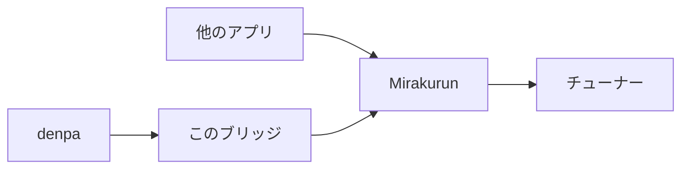

# denpa-mirakurun-bridge

[denpa](https://github.com/danything/denpa) のチューナーエージェント API (`/denpa/*`) を [Mirakurun](https://github.com/Chinachu/Mirakurun) へ中継するブリッジです。
denpa 付属のエージェントの代わりに使うことで、denpa と他のアプリが同じ Mirakurun のチューナーを共有できます。



> [!IMPORTANT]
> このブリッジは denpa・Mirakurun から独立した非公式プロジェクトです。質問や不具合の報告は、このリポジトリの Issues にお寄せください。

## 必要な環境

- Docker Compose
- denpa v2.28.0 以降
- Mirakurun

## 使い方

Mirakurun の `channels.yml` には、地上波は物理チャンネル番号（例：`27`）、衛星は中継器番号で始まる名前（例：`BS15_0`、`CS2`）を指定します。

denpa の `compose.override.yml` のtuner-agentを差し替える形で使用できます。

```yaml
services:
  tuner-agent:
    image: ghcr.io/multiverse2011/denpa-mirakurun-bridge:latest
    cap_add: !reset []
    device_cgroup_rules: !reset []
    stop_grace_period: 10s
    volumes: !override
      - bridge-config:/config
    environment:
      MIRAKURUN_URL: http://mirakurun.lan:40772
      PRIORITY_MAP: "10:2,9:1,8:0,5:0,4:0,3:0,1:0"
volumes:
  bridge-config:
```

## 設定

| 環境変数 | 既定値 | 用途 |
| --- | --- | --- |
| `MIRAKURUN_URL` | `http://127.0.0.1:40772` | Mirakurun の接続先 |
| `HOST` / `PORT` | `127.0.0.1` / `25252` | 待ち受けアドレスとポート。Docker では `HOST=0.0.0.0` |
| `PRIORITY_MAP` | なし | denpa と Mirakurun の優先度の対応表（例：`10:2,9:1`）。未指定の値はそのまま渡し、負の値は 0 にする |
| `KEYLESS_TUNERS` | `1` | 番組表・ロゴの取得とスキャンに新たに使えるチューナー数。BS と CS は合算 |
| `DECODE_KEYLESS` | `0` | `1` で番組表・ロゴの取得とスキャンでも復号する。ライブと復号済みストリームを共有できるが、デコーダの不調は番組表の取得にも影響する |
| `EPG_MODE` | `broadcast` | 番組表の取得方法。`synthetic` で Mirakurun の番組表から合成（実験的機能）。変更後は再起動が必要 |
| `CHANNELS_FILE` | `data/channels.json` | denpa から受け取ったチャンネル一覧の保存先。Docker では `/config/channels.json` |
| `AGENT_TLS` | `1` | `0` で HTTP 接続に切り替える（denpa v2.27.0 以前向け） |
| `AGENT_PAIR_TOKEN` | 自動生成 | denpa とのペアリングに使うトークン |
| `AGENT_NAME` | なし | denpa に表示する名前。省略時は URL のホスト名 |
| `ALLOWED_HOSTS` | なし | HTTP 接続で追加で許可するホスト名。IP アドレス、`localhost`、ドットのない名前、`.local` などは指定不要 |
| `DENPA_VERSION` | `bridge-<バージョン>` | denpa に通知するバージョン。denpa 本体と揃えると不一致の通知を抑えられる |
| `SHUTDOWN_WAIT` | `21600000`（6 時間） | 停止時に録画の終了を待つ上限（ミリ秒）。待機中も新しい要求を受け付ける。`0` で即時停止 |
| `MESSAGE_LANG` | `ja` | エラー応答とログの言語（`ja` / `en`） |


## 開発

ビルドと実行:

```sh
go build
MIRAKURUN_URL=http://mirakurun.lan:40772 ./denpa-mirakurun-bridge
```

テスト:

```sh
go test -race ./...
```

## ライセンス

[Apache License 2.0](LICENSE)

ただし [tls.go](tls.go) は denpa のチューナーエージェント (`agent/Denpa.Agent/AgentTls.cs`) から移植したため、元と同じ [MPL-2.0](https://mozilla.org/MPL/2.0/) です。
このファイルを改変して配布する場合は、そのファイルを MPL-2.0 で公開してください。

[internal/arib/jis0208.go](internal/arib/jis0208.go) と [internal/arib/aribextra.go](internal/arib/aribextra.go) の文字の対応表は、WHATWG Encoding Standard と denpa / libaribcaption の表から生成したものです。出典とライセンスの文面は [NOTICE](NOTICE) にまとめています。
